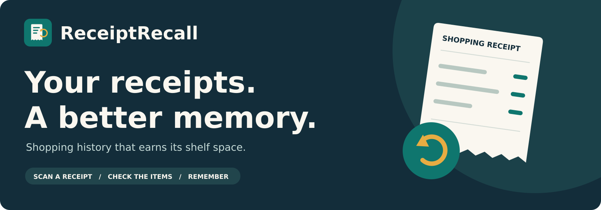

<p align="center">
  
</p>

# ReceiptRecall

**Your receipts. A better memory.**

Turn photographed grocery receipts into a corrected, saved purchase history with unit-price comparison. Private, local-first, open weights.

<p align="center">
  <a href="https://nextjs.org/"></a>
  <a href="https://www.typescriptlang.org/"></a>
  <a href="https://tailwindcss.com/"></a>
  <a href="https://www.sqlite.org/"></a>
  <a href="https://github.com/ollama/ollama"></a>
  <a href="https://zod.dev/"></a>
  <a href="https://sharp.pixelplumbing.com/"></a>
  <a href="https://vitest.dev/"></a>
  <a href="https://playwright.dev/"></a>
</p>

---

## Quick Start

```bash
# Install dependencies
npm install

# Copy env and adjust if needed
cp .env.example .env.local

# Run dev server
npm run dev
```

Open [http://localhost:3000](http://localhost:3000) with your browser.

## Commands

| Command | Description |
|---|---|
| `npm run dev` | Start development server |
| `npm run build` | Production build |
| `npm run start` | Start production server |
| `npm run lint` | Run ESLint |
| `npm run typecheck` | Run TypeScript compiler check |
| `npm test` | Run Vitest unit tests |
| `npm run test:e2e` | Run Playwright E2E tests |

## Architecture

```
Phone/browser ──HTTPS──> Caddy (TLS + basic auth) ──> Next.js :3000 ──> Tesseract CLI (OCR)
                                                             │
                                                             ├──> SQLite file  (data/receipts.sqlite)
                                                             ├──> images       (data/images/<uuid>.png)
                                                             └──> Ollama :11434 (gemma3:1b)   [server-only]
```

- One Linux VPS runs all of it via Docker Compose.
- Nothing but Caddy exposes a host port.
- Receipt images live **outside** `public/`, served only through the protected image route.
- `data/` and `.env*` are git-ignored.

## Project Structure

```
src/
├── app/                    # Next.js App Router pages & API routes
├── components/             # React components
├── lib/                    # Server-only utilities (DB, OCR, calculations, extraction)
└── ...
data/
├── images/                 # Normalized receipt PNGs (git-ignored)
└── receipts.sqlite         # SQLite database (git-ignored)
public/
├── assets/                 # Brand assets (readme-banner.svg)
├── favicon.ico
├── icon.svg
├── apple-icon.png
├── icon-192.png
├── icon-512.png
└── site.webmanifest
tests/
├── fixtures/               # Test fixtures
└── ...                     # Vitest & Playwright tests
```

## Deployment

Production deployment config (Phase 6) — `Dockerfile`, `compose.yaml`, `Caddyfile` not yet added.

## License

MIT — see `LICENSE` for details.